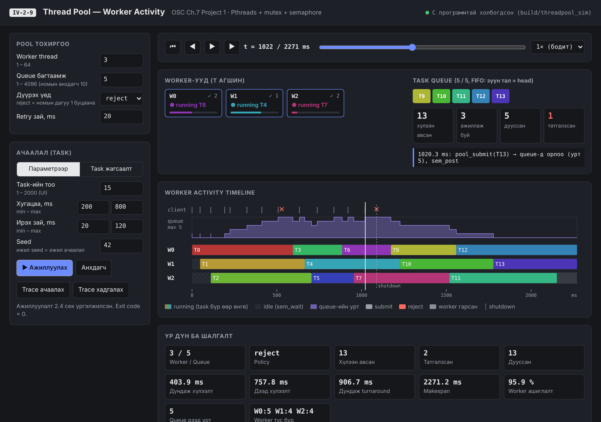
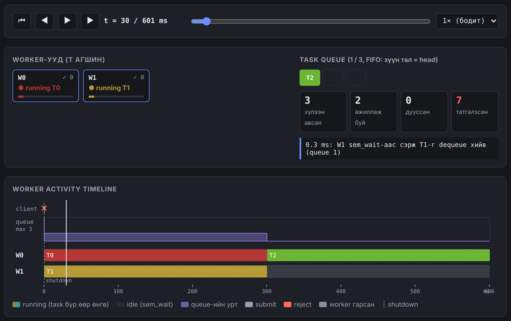
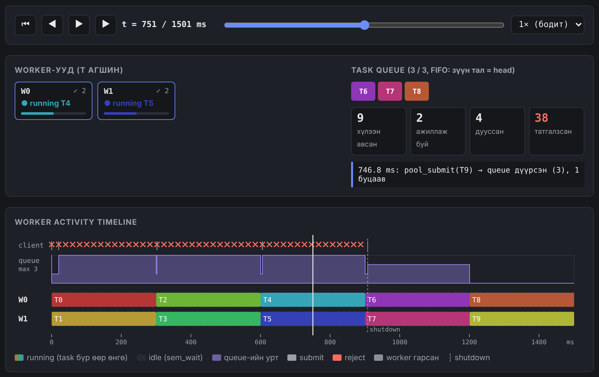
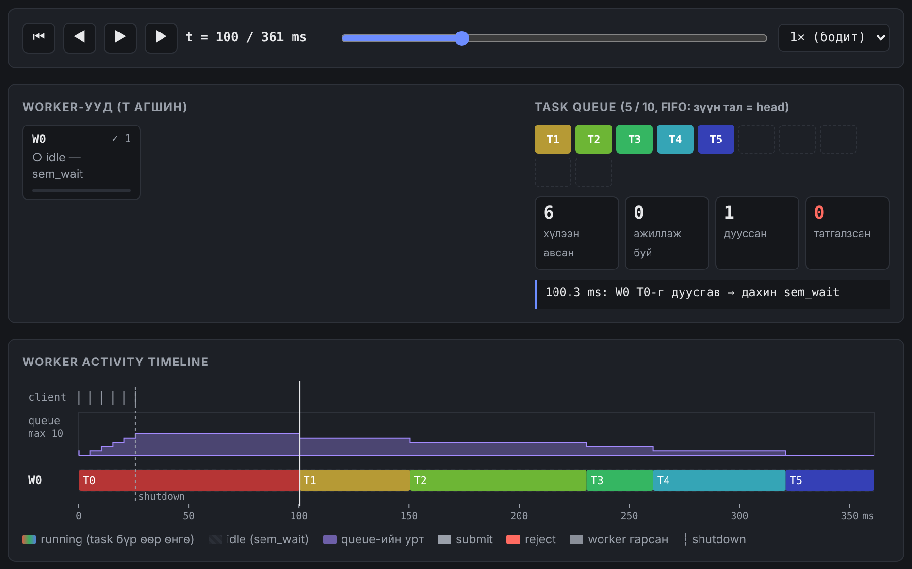
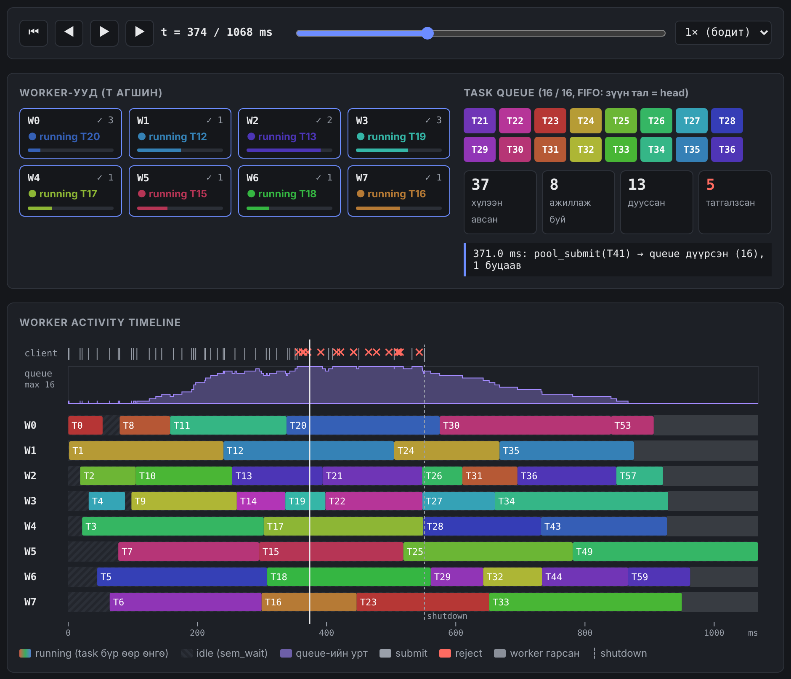

# IV-2-9 — Designing a Thread Pool (Worker activity)

**F.CSM302 Үйлдлийн систем · Бие даалт 1 · ШУТИС**

OSC 10th ed., 7-р бүлэг, Programming Project 1 (POSIX). Thread pool-ийг C хэл, pthread, mutex, semaphore ашиглан хэрэгжүүлж, worker бүрийн ажиллагааг вэб UI дээр харуулна.

## Онлайн үзэх

- **[Worker activity UI](app/)** — "Trace ачаалах" товчоор доорх жишээ файлын аль нэгийг нээнэ.
- Жишээ trace: [sample_trace.json](app/sample_trace.json) · [sample_burst_reject.json](app/sample_burst_reject.json)
- [Тайлан (PDF)](IV-2-9_BD1_Report.pdf) · [Гарын авлага (PDF)](IV-2-9_Manual.pdf)
- [Эх код (GitHub)](https://github.com/NominjinNomio/F.CSM302-BD_IV-2-9-threadpool)

## Өөрийн компьютер дээр бүрэн ажиллуулах

```bash
git clone https://github.com/NominjinNomio/F.CSM302-BD_IV-2-9-threadpool.git
cd F.CSM302-BD_IV-2-9-threadpool
make && make test && make ui     # дараа нь http://localhost:8000
```

## Дэлгэцийн зураг



**Queue дүүрэх үед татгалзах (reject):**



**Дахин илгээх (retry):**



**FIFO дараалал — 1 worker:**



**8 worker:**



## Багийн гишүүд

| № | Нэр | Оюутны код |
|---|-----|-----------|
| 1 | Ц.Номинжин | B241940137 |
| 2 | Е.Айсауле | B221940407 |
| 3 | Б.Балжинням | B231940033 |
| 4 | М.Бат-Орших | B200930061 |
| 5 | Г.Хулан | B241940027 |
| 6 | Э.Энхсайхан | B242270097 |
